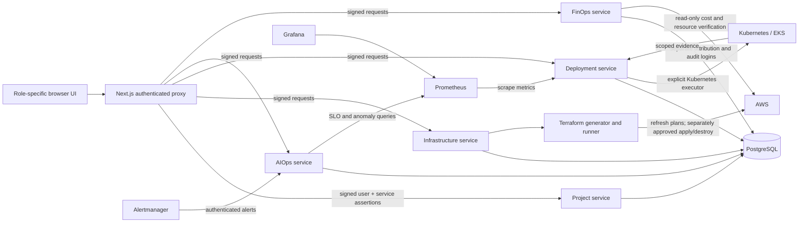

# CloudForge AI

CloudForge AI brings four projects into one Go, Python and Next.js application.

| Project | Implemented scope | Verification boundary |
| --- | --- | --- |
| **Internal AI DevOps Platform** | Individual accounts, role dashboards, project ownership, no-code infrastructure requests, saved-plan approvals, deployment history and operational observability. | Local application, database and browser workflows have been tested. Real resource creation, teardown and EKS delivery await approved live acceptance. |
| **AI Kubernetes Agent** | Project-scoped pod, rollout, warning-event, restart, usage and redacted-log evidence; deterministic diagnoses and recommendations; persisted diagnostic history. | Executor and authorization tests cover the integration. Actual EKS evidence and workload rollback await cluster validation. |
| **AI Cloud Cost Detective** | Cost Explorer clients, cost quality labels, anomalies, pricing estimates, optimization recommendations, verified EC2 project attribution and durable cost audit captures. | Read-only Cost Explorer access and local audit persistence have been exercised. Complete project billing for newly provisioned resources remains unverified. |
| **Terraform Drift Detection** | On-demand refreshed observation plans, provider-drift versus desired-change classification, severity, recommendations and project-scoped scan history. | Local parser, repository, authorization and UI tests cover the workflow. Detection against real managed AWS resources awaits live verification. |

Status labels refer to code and local tests. Production acceptance is a separate gate. See the [release checklist](deploy/RELEASE_CHECKLIST.md) for dated local verification and outstanding deployment gates.

## Architecture



Terraform drift scanning reuses infrastructure-service. Kubernetes diagnosis reuses deployment-service. Cost investigation reuses FinOps and AIOps interfaces. These capabilities share identity and project records through PostgreSQL.

| Component | Repository path | Local port |
| --- | --- | --- |
| Next.js frontend | `frontend/` | 3000 |
| Project service | `services/project-service/` | 8080 |
| Infrastructure service | `services/infrastructure-service/` | 8081 |
| Deployment service | `services/deployment-service/` | 8082 |
| AIOps service | `services/aiops-service/` | 8090 |
| FinOps service | `services/finops-service/` | 8091 |
| Prometheus / Grafana / Alertmanager | `monitoring/` | 9090 / 3001 / 9093 |

The frontend pins Next.js 16.4.5 and uses Node 22 in its production Dockerfile. Backend services use Go 1.26.11 and Python 3.12; PostgreSQL uses version 16. The infrastructure image includes Terraform 1.17.2. Versions and build inputs are defined in the service Dockerfiles, module files and lockfiles. See [local image CVE remediation evidence](deploy/security/BATCH32_IMAGE_REMEDIATION.md).

## 1. Internal AI DevOps Platform

### Projects, accounts and dashboards

- PostgreSQL accounts retain username as the login identifier, with optional validated email.
- Platform Engineers manage users, roles, activation, session revocation and project memberships through `/administration`. Administrative changes have transactional audit records and replay protection.
- New projects belong to their verified creator. Membership levels are owner, maintainer and viewer. Legacy projects require explicit verified ownership before Developer access.
- Developer, SRE and Platform Engineer dashboards expose different navigation and actions. Backend authorization also checks direct API requests.

| Role | Supported access |
| --- | --- |
| `platform-engineer` | Platform administration, account/membership management, infrastructure review and execution, and operational visibility. |
| `sre` | Operational observability, incidents, permitted remediation workflows, read-only infrastructure/cost visibility and authorized diagnostics. Terraform mutations are denied. |
| `developer` | Authorized project creation and management, infrastructure requests and plans, application deployments, and read-only scoped telemetry/costs. Viewers cannot make project mutations. Terraform approval/apply/destroy are denied. |

Resource authorization derives relationships from backend records. Some project-management routes additionally require project membership, including for operational users.

### No-code infrastructure lifecycle

Guided forms cover EC2, VPC, S3, RDS and EKS. The generator also supports load balancers. Inputs and provider dependencies are validated by the existing service and Terraform paths.

The implemented workflow is request → saved plan → submission → independent Platform Engineer approval → apply → execution outcome. Destruction has a separate saved-plan review and execution flow.

Approvals bind the plan hash, revision, operation, project, environment and requester. Approval expiry, self-approval checks and atomic execution claims prevent reuse of an unrelated or stale decision. Plan output exposed to the UI is summarized to avoid sensitive values.

Inventory distinguishes workflow state, Terraform state identifiers and independent AWS verification. A recorded state ID does not establish current AWS health; the API can explicitly report that health as unverified. Failed or partial destruction requires reconciliation and a fresh approval-bound plan.

**Local Compose defaults to Terraform read-only mode.** Production execution requires a configured remote backend and role chain. AWS bootstrap and live apply/destroy are separate approval boundaries.

### Deployments and observability

PostgreSQL is the durable deployment queue. Conditional transitions, transactional attempt allocation, execution leases and ownership fencing protect deployment history across concurrent workers and restarts. Kubernetes execution includes reconciliation and bounded recovery paths.

Deployment API, history and UI label simulated, Kubernetes and unknown legacy execution. Local Compose defaults to simulated deployment execution. An EKS workload rollout is still a separately configured and verified integration.

The observability console includes SLOs, error budgets, burn rates and statistical anomalies. Availability, request-success and latency SLOs require window coverage and fresh measurements. The default seven-day window needs 90% coverage at the configured scrape interval; the local scrape interval is 15 seconds. Missing evidence displays N/A or insufficient data. Five-minute evidence and seven-day compliance are evaluated independently.

Anomaly detection requires at least five recent samples. A newly started or sparsely sampled environment can legitimately show insufficient data while the scrape target is healthy.

## 2. AI Kubernetes Agent

The diagnostics panel verifies the deployment's project and namespace, follows Kubernetes ownership metadata, and inspects a bounded sample of one pod. It can recognize evidence such as OOM termination, image-pull failure, scheduling or mount problems, probe failure, restart backoff and rollout deadline failure.

CPU and memory readings require a working Kubernetes Metrics API. Restart monitoring additionally depends on the relevant Prometheus series and labels. Diagnostic history stores structured evidence and the signed actor, excluding raw log lines and event messages.

The current Kubernetes diagnosis is **rule-based**. Optional incident AI enrichment is implemented through disabled, mock, OpenAI-compatible and Bedrock provider modes. Local Compose explicitly selects mock enrichment; its output is test/demo output. Live model integration requires configuration and separate verification.

Viewing diagnostics executes no remediation. Supported remediation operations require trusted persisted human approval and policy checks. AI text cannot authorize arbitrary commands or infrastructure execution.

## 3. AI Cloud Cost Detective

FinOps integrates AWS Cost Explorer, pricing, budgets and resource inspection where the corresponding API and permissions are available. Responses distinguish actual costs, estimates and unavailable evidence. The analytical API can also process supplied inventory, which requires independent verification before it can establish AWS evidence.

Project cost access currently supports **verified EC2 attribution**. It checks persisted project/resource mappings, account, region, environment and live resource identity/tags before requesting resource-specific billing data. Missing attribution, permissions or billing samples fail closed. Developers receive project-scoped read-only results.

Cost anomalies compare daily evidence against a historical baseline and distinguish estimates. A missing baseline or malformed billing data produces insufficient/unavailable results. Optimization recommendations expose savings only where pricing and utilization evidence support them.

Operator cost captures persist evidence and the signed actor in PostgreSQL. They require a separate audit DSN. The attribution DSN remains read-only.

Incident pages can display cost evidence when persisted incident identifiers match a verified project/resource attribution. Matching identifiers associate the evidence; causal investigation remains separate. Unsupported resource attribution displays unavailable.

## 4. Terraform Drift Detection

Platform Engineers and SREs can request scans for active resources. Authorized project users can read applicable history. Each scan generates a private temporary workspace for the existing remote backend and runs a refreshed Terraform observation plan with locking disabled.

Findings distinguish `resource_drift` from desired configuration changes, identify supported resource types/addresses, classify removal/replacement risk, and give review recommendations. Raw plan values are not published. PostgreSQL records scan status, actor, findings and time; a changed resource revision invalidates a stale scan.

Drift remediation uses the existing infrastructure workflow with a **fresh saved plan and Platform Engineer approval**. There is no automatic repair. Current alerts are dashboard findings; scheduled fleet scanning and external drift notifications are planned.

## Security model

- Passwords use salted PBKDF2 hashes. Opaque session tokens are stored as hashes. Session expiry, revocation, deactivation and role changes are enforced through the account store.
- Cookie sessions and CSRF checks protect browser mutations. Production cookies require HTTPS. Backend assertions validate issuer, audience, signature, expiry, method and request target; sensitive operations also bind the body and enforce replay protection.
- Caller-provided role, actor or approval headers do not establish authority. Terraform decisions and sensitive remediation approvals resolve trusted persisted state.
- Project authorization is enforced in backend list, detail and action paths. Kubernetes namespace/pod selectors and FinOps resource mappings are validated independently of client claims.
- Logs use bounded queries and pattern-based redaction. Redaction cannot guarantee removal of every application-specific secret.
- Credentials, runtime environment files, Terraform state/plans and generated secret configuration stay outside Git. `.env.example` and Kubernetes examples contain placeholders. The frontend Docker context excludes `.env*`.
- Use scoped workload identity and secret references for deployment. Actual target IAM, role assumption, state locking, secret access and recovery remain acceptance gates.

The [deployment guide](deploy/kubernetes/README.md), [bootstrap runbook](infrastructure/terraform/bootstrap/README.md) and [release checklist](deploy/RELEASE_CHECKLIST.md) document the target-environment requirements.

## Local setup

Docker with Compose is required for the local stack. Source tests additionally need Node 22, Go 1.26.11, Python 3.12 and the dependencies in each module/lockfile.

From the repository root, preserve any existing private configuration.

```bash
test -f .env || cp .env.example .env
chmod 600 .env
# Edit .env privately and set a strong POSTGRES_PASSWORD.
# Leave AWS credential placeholders empty for local-only work.
python3 scripts/bootstrap-local-auth.py
docker compose config --quiet
docker compose up -d --build
docker compose ps
```

The authentication helper generates independent signing and session keys without printing them. Local startup does not authorize cloud operations. Terraform remains read-only and deployments remain simulated until explicitly configured otherwise.

Bootstrap an administrator only when the account store is empty.

```bash
read -rp 'Administrator username: ' cloudforge_bootstrap_user
read -rsp 'New password (at least 15 bytes): ' cloudforge_bootstrap_password
printf '\n'
printf '%s\n' "$cloudforge_bootstrap_password" |
  docker compose exec -T project-service /app/project-service account bootstrap "$cloudforge_bootstrap_user"
unset cloudforge_bootstrap_password cloudforge_bootstrap_user
```

Open `http://localhost:3000` and sign in. Browser administration is available to Platform Engineers. The account CLI also supports create, set-role, set-email, activate, deactivate and revoke operations; password-taking commands read stdin.

For optional project cost/audit persistence, provision the restricted database logins and set `FINOPS_PROJECT_DATABASE_URL` and `FINOPS_AUDIT_DATABASE_URL` through private configuration. See the deployment guide for table grants. AWS-backed results remain unavailable until approved credentials and verified resource mappings exist.

Use `docker compose logs --tail=100 SERVICE` for diagnostics. Preserve PostgreSQL and Prometheus volumes when stopping or updating the stack.

## Database and migration order

Go services embed their PostgreSQL migrations and run them before serving requests.

1. Project service applies migrations 001–006, including `006_browser_admin_audit.sql`.
2. Infrastructure service applies 001–011 and deployment-service applies 001–005.
3. AIOps initializes its own schema at startup. FinOps starts after the project and infrastructure tables exist.
4. Start the frontend after backend readiness.

The 22 Go-service migration receipts share `schema_migrations` with distinct filenames. Production Compose encodes the relevant health dependencies. Historical migration files are retained; new schema changes are additive. Back up and verify restore before a real rollout.

## Tests and verification

Install the Python test environments from the committed lockfiles.

```bash
for service in aiops-service finops-service; do
  python3 -m venv "services/$service/.venv"
  "services/$service/.venv/bin/python" -m pip install --require-hashes -r "services/$service/requirements.lock"
done

(cd services/service-identity && go test -race ./...)
(cd services/project-service && go test -race ./internal/accounts ./internal/handler ./internal/service)
(cd services/infrastructure-service && go test -race ./internal/config ./internal/handler ./internal/service ./internal/terraform)
(cd services/deployment-service && go test -race ./internal/metrics ./internal/handler ./internal/service ./internal/executor ./internal/worker)

(cd services/aiops-service && .venv/bin/python -m pytest -q)
(cd services/finops-service && .venv/bin/python -m pytest -q)
(cd frontend && npm ci && node --test tests/*.test.mjs && npx tsc --noEmit)
```

Database tests are separate. Account/session and deployment execution integration tests use `DATABASE_URL` with the `integration` build tag. Repository suites use `TEST_DATABASE_URL`; some clean their test tables, so use a disposable database/schema. Missing database configuration can skip these checks.

```bash
scripts/test-finops-audit-postgres.sh
services/aiops-service/.venv/bin/python monitoring/prometheus/test-slo-evidence.py
docker run --rm --network none --entrypoint /bin/promtool \
  -v "$PWD/monitoring/prometheus:/fixtures:ro" -w /fixtures \
  prom/prometheus:v3.5.0 test rules availability-burn.test.yml
```

The FinOps runner uses the existing local Docker PostgreSQL and a temporary schema. The SLO fixture scales the production window while preserving coverage/freshness logic.

Playwright covers the three roles, project creation, browser administration, negative authorization, CSRF and logout. Use dedicated test accounts and follow the [browser test instructions](frontend/e2e/README.md). Run `npm run test:e2e` from `frontend/`; role tests are skipped when credentials are absent.

For secret scanning, use Gitleaks with redacted output and review both tracked files and Git history. Verified placeholders, deterministic test constants and non-secret metric/idempotency identifiers must be classified narrowly. Keep reports private and never paste detected values.

## Current limitations and verification status

- **Locally verified** — account/session/RBAC behavior, project isolation, no-code forms and request persistence, approval/replay checks, queue ownership, audit persistence, drift parsing, simulated-versus-real labels, browser workflows and controlled observability scenarios.
- **Implemented but partially integrated** — one-pod Kubernetes diagnosis, incident-to-cost evidence matching, per-capability audit views, and EC2-only project billing attribution. These have explicit evidence/unavailable states.
- **Awaiting live AWS/EKS verification** — bootstrap IAM and S3 controls, actual locking/role assumption, approved EC2/VPC/S3/RDS/EKS provisioning and cleanup, runtime secret delivery, EKS rollout/rollback, real diagnostic evidence and drift against managed AWS resources.
- **History-dependent** — seven-day SLO coverage and billing/anomaly baselines need real samples. Target readiness alone cannot establish compliance or cost evidence.
- **Deployment-specific** — production TLS, backup/restore, concurrency/load behavior, alert delivery and least-privilege workload grants require validation in the intended environment.

The local stack includes simulated execution and optional mock AI enrichment. Those modes are labeled. AWS, Kubernetes and model-provider acceptance require evidence from configured live integrations.

## Roadmap

Planned work includes verified billing attribution beyond EC2, scheduled drift scans and notifications, multi-pod and temporal diagnostics, richer evidence-based incident/cost investigation, consolidated audit search, and broader production recovery/load testing.

Before deploying, complete the release checklist, publish reviewed image digests, configure target secrets and IAM, and obtain separate approvals for bootstrap and each live resource lifecycle. Cloud deployment and cleanup are outside local development sign-off.
